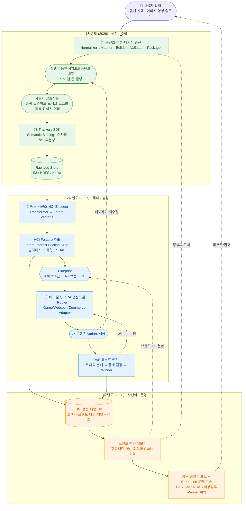

# 개요 (MOC)

> **사용자의 미세행동(HCI) 데이터를 수집·해석해서, 인터랙티브 광고 콘텐츠를 자동 생성·개선하는 Closed-loop 마케팅 솔루션.**
> → 투자대비광고수익률(ROAS) 2배 이상 증대, 콘텐츠 제작 비용·시간 90% 절감 목표.

## 전체 구조
![[개요_전체구조도.png]]

## 전체 Flow
`콘텐츠 생성·배포` → `HCI 행동데이터 수집` → `HCI Encoder → Feature 추출(Blueprint)` → `버티컬 QLoRA 생성` → `새 Variant` → `A/B 테스트` → `Winner 반영` → 다시 생성

## 전체 순환 흐름도

## 3단계 순환 흐름
- **생성·수집 (1차년도)**: 사용자 입력(옵션·이미지·영상) → 콘텐츠 생성·패키징 엔진 → 실행 가능한 HTML5 배포 → 사용자 상호작용(클릭·스와이프·체류·망설임·이탈) → JS Tracker/SDK → Raw Log Store
- **해석·생성 (2차년도)**: 행동 시퀀스 스트림 → HCI Encoder(Transformer, Latent Vector z) → HCI Feature 추출(Intent·Interest·Friction·Drop + SHAP) → **버티컬 QLoRA 생성모델** → 새 콘텐츠 Variant → A/B 테스트 → Winner 반영
- **자산화·운영 (3차년도)**: 누적 행동·성과 → HCI 행동 패턴 DB + 브랜드 최적화 Cycle 이력 → **브랜드 행동 메모리** 검색 → Blueprint/priors로 생성모델·콘텐츠엔진에 되먹임 → 자동 성과 리포트·운영 콘솔

## 전체 체인 · 모듈 I/O (3개 핵심 모듈)
> 핵심 모듈은 **① 콘텐츠 생성 · ② HCI Encoder+예측 · ③ QLoRA 생성모델** 3개. 이 중 **딥러닝(뉴럴)은 ②·③ 뿐**이며 ①은 템플릿/규칙 엔진. A/B 테스트·자산화 DB는 루프를 돌리는 **운영 모듈**로, 핵심 모델에는 포함하지 않는다.

| 모듈                              | 정체                                                   | 성격             | 입력 → 출력                                                                                     |
| ------------------------------- | ---------------------------------------------------- | -------------- | ------------------------------------------------------------------------------------------- |
| ① 콘텐츠 생성·패키징 엔진 (1차)            | Normalizer → Mapper → Builder → Validator → Packager | ❌ 비-AI (소프트웨어) | 옵션 + 에셋 → 실행 가능 HTML5                                                                       |
| ② HCI Encoder + Feature 추출 (2차) | Transformer 표현학습 + 멀티태스크 예측                          | ✅ 딥러닝          | 행동 이벤트 시퀀스 → 점수 4종(intent/interest/friction/drop-off) + SHAP 근거 |
| ③ 버티컬 QLoRA 생성모델 (2차)           | Router → 업종별 LoRA 어댑터 생성형 LLM                        | ✅ 생성형          | Blueprint(②점수 4종 + 3차 브랜드 누적 DB) + 캠페인 목표·타깃 → 실제 카피·CTA·레이아웃·인터랙션 (새 Variant) |

**연결 포인트 (헷갈리기 쉬운 부분)**
- **Blueprint = ② 예측 4값 + ③ 3차년도 브랜드 누적 DB.**
  ②의 MLP Head가 낸 점수 4종(intent/interest/friction/drop-off)과 3차년도에 쌓인 브랜드별 행동패턴·우수패턴 DB가 결합되어 **Blueprint**를 이룬다.
  별도의 rule 기반 정책엔진을 두지 않고, **LLM이 Blueprint를 직접 읽고** 카피/CTA/레이아웃을 생성.
  *왜 그 점수인지*는 ②의 SHAP 근거로, *왜 이 카피인지*는 생성 근거(reasoning)로 남아 설명가능성 확보.

- **"generation"이 두 개**임에 주의:
  ①(결정적 템플릿 조립) ≠ ③(LLM 카피·CTA 생성). 발표에서 용어 분리 필요.

- **③ LLM 출력 경계**는 *JSON Schema로 고정된 **콘텐츠 명세(Content Spec)*** (카피/CTA/레이아웃/인터랙션/컴포넌트 파라미터) 로 한정.
  LLM은 HTML을 자유 생성하지 않고 콘텐츠 명세만 내며, HTML5 조립은 ①에서의 generation이 담당.

- **3차년도 자산 레이어 = 브랜드 행동 메모리**: 누적 행동·성과와 최적화 Cycle 이력을 **브랜드 행동 메모리**로 축적하고, 검색해 **Blueprint(입력)** 에 결합하거나 **priors(정책/피드백 흐름)** 로 ③ 생성모델·① 콘텐츠엔진에 되먹인다. → 실시간 생성 경로엔 규칙엔진이 없고, 브랜드 누적 자산만 컨텍스트로 얹힌다.

## Core Components
1. **생성→수집 루프**: 콘텐츠 배포 → 사용자 행동 → 수집 (데이터를 계속 만들어냄)
2. **해석→개선 루프 (Closed-loop 본체)**: Feature → 예측(Blueprint) → 생성 → A/B → Winner → 다시 생성
3. **자산화 루프 (플라이휠)**: 누적 데이터 → 행동패턴 DB·최적화 이력 → 브랜드 행동 메모리 → 다음 캠페인 품질↑ → 데이터 해자

## 솔루션 구성 (3대 엔진)
### ① 인터랙티브 콘텐츠 생성 및 HCI 행동데이터 수집 기반 엔진
- 사용자가 선택한 옵션 + 업로드한 이미지·영상을 **실행 가능한 HTML5 콘텐츠로 변환**하는 생성 기반 구축
- 생성 콘텐츠 내 **사용자 미세행동을 수집**하는 데이터 측정 환경 구축
- 후속 AI 학습을 위한 **표준 HCI 원천 데이터** 확보

### ② HCI Feature 기반 Closed-loop 콘텐츠 개선 자동화 엔진
- 수집된 행동데이터를 **구매의도·관심도·불편도·이탈징후**로 변환하는 AI 분석 기반 구축
- 분석 결과를 **Blueprint**로 삼아 버티컬 QLoRA 생성모델이 콘텐츠를 직접 생성
- A/B 테스트 결과를 다음 콘텐츠 개선안에 자동 반영하는 **폐쇄루프(Closed-loop)** 구현

### ③ 브랜드별 Behavior AI · 콘텐츠 자산 최적화 엔진
- 반복 캠페인에서 축적된 행동·성과 데이터를 **브랜드별 고유 자산**으로 구조화
- 고성과 카피·CTA·레이아웃·인터랙션 조합을 **브랜드 행동 메모리로 자산화**
- 고객사별 맞춤 추천·성과관리·운영이 가능한 상용 최적화 체계 완성

## 목차
- [[2. 연차별계획]] — 연차별 최종 목표 + 표준화 전략
- **1차년도 (2026)**
  - [[2a.(1차년도) 콘텐츠생성-패키징엔진]]
  - [[2b.(1차년도) JS-Tracker-SDK-이벤트스키마]]
- **2차년도 (2027)**
  - [[2c.(2차년도) Intent-Friction모델-QLoRA⭐]] ⭐ 핵심 AI
  - [[2d.(2차년도) AB테스트-Winner추천]]
- **3차년도 (2028)**
  - [[2e.(3차년도) 행동메모리자산화-콘텐츠생성]]
  - [[2f.(3차년도) 성과리포트-운영콘솔]]
- [[3. 성능목표-평가지표]]
- [[5. 연구개발현황]]
- [[6. 지재권-특허현황]]
- [[4. 업무분장-추진일정]]
- 📚 LoRA/QLoRA 개념 — 기술서 읽기용 배경지식
- 🔎 [[_FEEDBACK_자문노트]] — 의문·보강·예상질문 (내부 자문용)

## 자주 나오는 용어
| 용어 | 뜻 |
|---|---|
| HCI | Human–Computer Interaction. 여기선 클릭·스와이프·드래그·스크롤·체류시간·망설임·이탈 같은 **미세행동** |
| Intent | 구매의도 (사고 싶어 하는 정도) |
| Interest | 관심도 |
| Friction | 불편도/프러스트레이션 (막히거나 짜증나는 정도) |
| Drop-off | 이탈위험 |
| Variant | A/B 테스트에서 비교하는 콘텐츠 버전 |
| Feature | 행동 로그에서 뽑아낸 분석용 변수 (체류시간, 망설임시간 등) |
| Vertical(버티컬) | 업종. 게임 · 웹툰 · 커머스 |
| Blueprint | **LLM 입력**. ② MLP Head 예측값(점수 4종) + 3차년도 브랜드별 누적 DB가 **결합**되어 ③ LLM 생성 컨텍스트에 들어가는 **콘텐츠 브리프**. 규칙엔진 없이 LLM이 이걸 읽고 생성 |
| 콘텐츠 명세 (Content Spec) | **LLM 출력**. LLM이 생성하는 구조화 결과(Copy·CTA·Layout·Interaction·Template Parameter). JSON Schema로 고정되며 ① 패키징 엔진이 이를 HTML5로 렌더 |
| 브랜드 행동 메모리 | 3차년도에 누적된 브랜드별 행동패턴 DB·최적화 Cycle 이력. 실시간 생성용 규칙엔진이 아니라, 검색해 Blueprint에 결합하거나 생성모델에 얹는 **priors 자산** |
