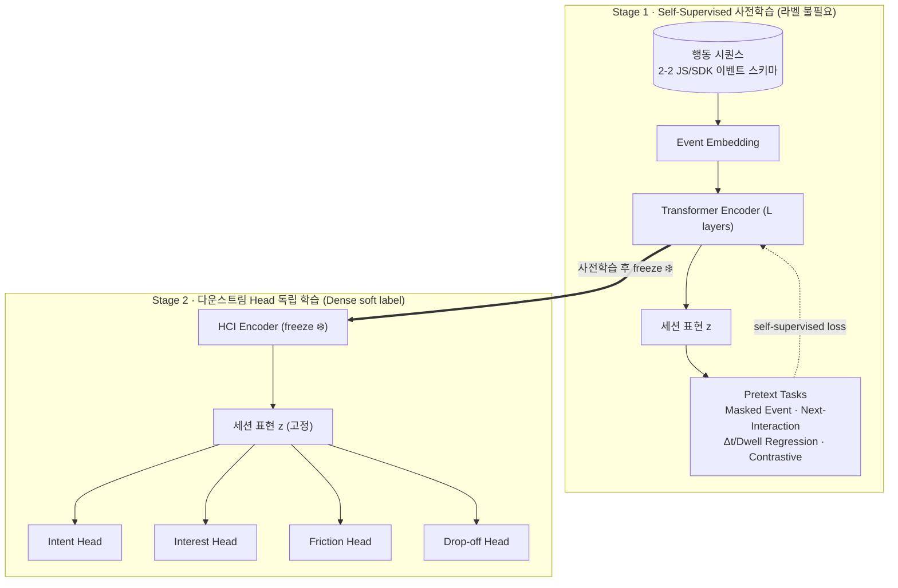
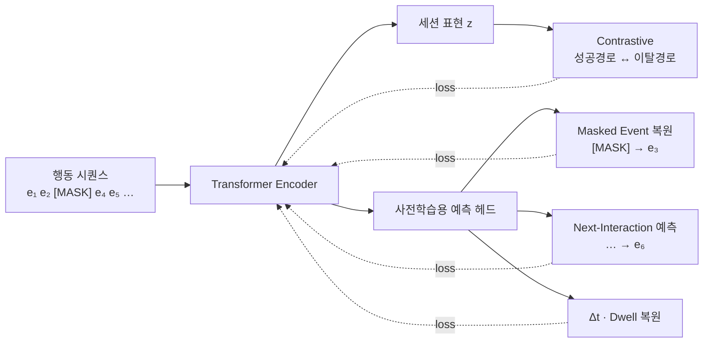
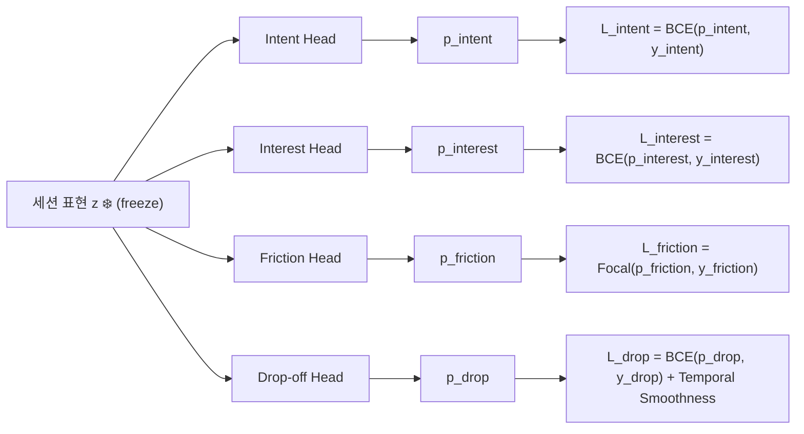
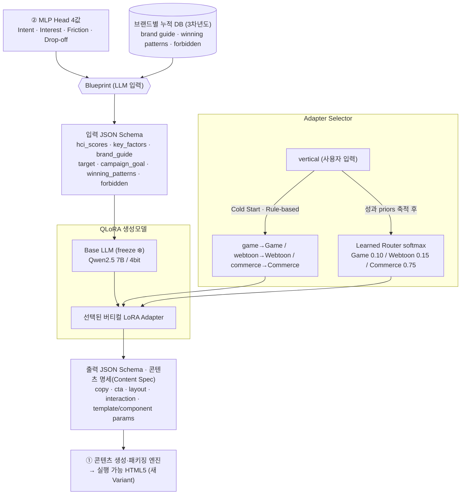

# (2-3) 2차년도 · HCI Feature 기반 Intent/Friction 판단모델 + 버티컬 QLoRA 파인튜닝 ⭐

## 목표
수집한 행동 로그에서 **HCI Feature**를 뽑아
→ **구매의도 · 관심도 · 불편도 · 이탈징후**를 예측하고
→ 그 예측값을 3차년도 브랜드별 누적 DB와 결합한 **Blueprint**로 생성 모델에 전달한다.
HCI Encoder는 **Self-Supervised 사전학습**으로 충분한 **Feature Representation**을 확보하고, 생성 모델은 **업종별 QLoRA 어댑터**로 특화한다.

## 개발 내용
- 원천 로그의 세션화·노이즈 제거 및 체류시간·망설임·상호작용 깊이 등 **HCI Feature 추출**
- **JS Tracker/SDK 이벤트 스키마(2-2)** 를 임베딩한 행동 시퀀스로 Transformer HCI Encoder를 **Self-Supervised 사전학습** → 라벨 없이 범용 **행동 표현(Feature Representation)** 확보
- 사전학습 표현 위에 구매의도·관심도·불편도·이탈징후 예측 **Head를 각각 독립 학습**(Dense soft label)
- 게임·웹툰·커머스 등 **버티컬별** 데이터·생성규칙을 반영한 경량 오픈모델 **QLoRA 파인튜닝**

## 학습 파이프라인 (2단계)
> Encoder를 먼저 **Self-Supervised로 사전학습**해 행동 표현을 확보한 뒤, 이를 **고정(freeze)** 하고 그 위에서 예측 Head를 **각각 독립적으로** 학습한다.

| 단계 | 대상 | 라벨 | 목적 |
|---|---|---|---|
| **Stage 1 — SSL 사전학습** | HCI Encoder (Transformer) | 불필요 (Self-Supervised) | 순서·간격·전환 경로를 담은 범용 세션 표현 z 학습 |
| **Stage 2 — 다운스트림 학습** | Intent/Friction 예측 Head 4개 | Dense soft label | freeze된 z 위에서 Head별 **독립** 예측기 학습 |




### ① 행동 시퀀스 기반 HCI Encoder — Self-Supervised 사전학습
행동 "횟수"가 아니라 **순서·간격·전환 경로**를 학습하는 시계열 인코더. Transformer 구조를 쓰며, **충분한 Feature Representation을 확보하기 위한 Self-Supervised Task로 사전학습**한다.
- 입력: `seq, event_type, element_id, x/y, dwell(ms), delta_t(ms)` 형태의 **Raw 이벤트 시퀀스** (2-2 스키마 임베딩; view/click/dwell/scroll/hover/back/exit …)
- **Event Embedding**: Event Type Emb. + Element Emb. + Time Gap Emb.(Δt bucket) + Numeric Feat. + Context Emb.
- **Sequence Encoding**: Positional Encoding → **Transformer Encoder (L layers)** → h₁…h_T
- **Session Pooling**: Attention Pooling → 고정 길이 **세션 표현 벡터 z ∈ ℝ^d** (d=128/256)


- **Self-Supervised Pretext Task (라벨 불필요)** — Encoder가 좋은 표현을 학습하도록 강제:
  - **Masked Event Modeling**: 시퀀스 내 이벤트(type/element/dwell) 일부를 마스킹 후 복원 (BERT식 MLM)
  - **Next-Interaction Prediction**: 다음 이벤트/요소를 예측 (자기회귀)
  - **Δt·Dwell Regression**: 마스킹된 시간정보(간격·체류) 복원 → 시간 구조 학습
  - **Sequence Contrastive (Vertical Path)**: 구매 성공 경로(Positive) vs 이탈 경로(Negative)를 **Contrastive/Triplet Loss**로 분리
  - → 이 pretext들이 라벨 없이 **순서·간격·전환 경로가 반영된 범용 표현 z**를 학습하게 한다
- 산출: 다운스트림에서 재사용하는 **사전학습된 세션 표현 z** (Stage 2에서 freeze)



### ② Intent/Friction 멀티태스크 예측 Head — Head별 독립 학습
**freeze된 사전학습 표현 z** 위에 예측 Head 4개를 각각 독립적으로 학습한다.
- Intent(구매의도) / Interest(관심도) / Friction(불편도) / Drop-off(이탈위험) → 각 `p ∈ 0~1`
- **Dense Labeling(조밀 라벨)**: 구매하지 않은 사용자까지 망설임·관심·이탈 신호로 라벨링 (event seq별 0.x 소프트라벨)
- **Head별 Loss Function** (각자 정의·독립 학습, class·confidence weighting 적용):
  - `L_intent   = BCE(p_intent, y_intent)`
  - `L_interest = BCE(p_interest, y_interest)`
  - `L_friction = Focal(p_friction, y_friction)`
  - `L_drop     = BCE(p_drop, y_drop) + Temporal Smoothness`
- 출력: 4개 예측값(score vector) + **key factor attribution (SHAP/IG)** — 왜 그 점수인지 근거 동시 산출
- 이 **4개 예측값**이 ③ 3차년도 브랜드별 누적 DB와 결합되어 생성 모델 입력 **Blueprint**를 이룬다



### ③ 버티컬 QLoRA Adapter Routing
공통 Base Model은 고정(freeze), **업종별 LoRA 어댑터만** 선택 학습·교체. → LoRA/QLoRA 개념

**Adapter Selector — Cold Start → Learned Router**
- **Cold Start (초기) · Rule-based**: 성과 데이터가 없을 때는 사용자가 입력한 `vertical` 값으로 어댑터를 규칙 선택
  - `vertical = game` → **Game LoRA Adapter**
  - `vertical = webtoon` → **Webtoon LoRA Adapter**
  - `vertical = commerce` → **Commerce LoRA Adapter**
- **이후 · Learned Router**: 성과 priors가 쌓이면 softmax router score로 확률적 선택·혼합 (예: Game 0.10 / Webtoon 0.15 / **Commerce 0.75**)
- **Base LLM**: 예시상 **Qwen2.5 7B / 4bit**(고정) 또는 Llama-3/Mistral 등 공통 오픈모델 → 여기에 Game / Webtoon / **Commerce** LoRA Adapter 부착

**입출력 스키마 고정 (JSON Schema)**
자연어 프롬프트만 던지면 결과가 흔들리므로 **LLM 입력·출력을 JSON Schema로 강제**한다. LLM은 HTML을 자유 생성하지 않고 **구조화된 콘텐츠 명세(Content Spec, JSON)** 만 출력 → 이를 **① 콘텐츠 생성·패키징 엔진**이 실제 HTML5로 렌더한다.

- **입력 스키마 = Blueprint** (② 예측 4값 + 3차년도 브랜드 DB) + 캠페인 정보
  - `hci_scores` · `key_factors` · `brand_guide` · `target` · `campaign_goal` · `winning_patterns` · `forbidden_expressions`
- **출력 스키마 = 콘텐츠 명세(Content Spec)**
  - `copy` · `cta` · `layout` · `interaction` · `template_component_params`

```json
// 입력 스키마 (예시)
{
  "hci_scores": { "intent": 0.82, "interest": 0.63, "friction": 0.71, "drop_off": 0.65 },
  "key_factors": ["cta_hesitation", "price_revisit", "scroll_stall"],
  "brand_guide": { "tone": "친근·신뢰", "palette": ["#0B5", "#111"], "logo_rules": "..." },
  "target": { "segment": "20-30 여성", "device": "mobile" },
  "campaign_goal": "click_to_purchase",
  "winning_patterns": ["benefit_top", "short_copy"],
  "forbidden_expressions": ["최저가", "100% 보장"]
}
```

```json
// 출력 스키마 · 콘텐츠 명세(Content Spec) (예시)
{
  "copy": { "headline": "...", "body": "..." },
  "cta": { "text": "지금 구매", "style": "primary" },
  "layout": { "order": ["hero", "benefit", "cta"], "emphasis": "cta_top" },
  "interaction": [{ "type": "reveal", "trigger": "scroll" }],
  "template_component_params": { "template_id": "T-commerce-03", "color": "brand.primary" }
}
```


